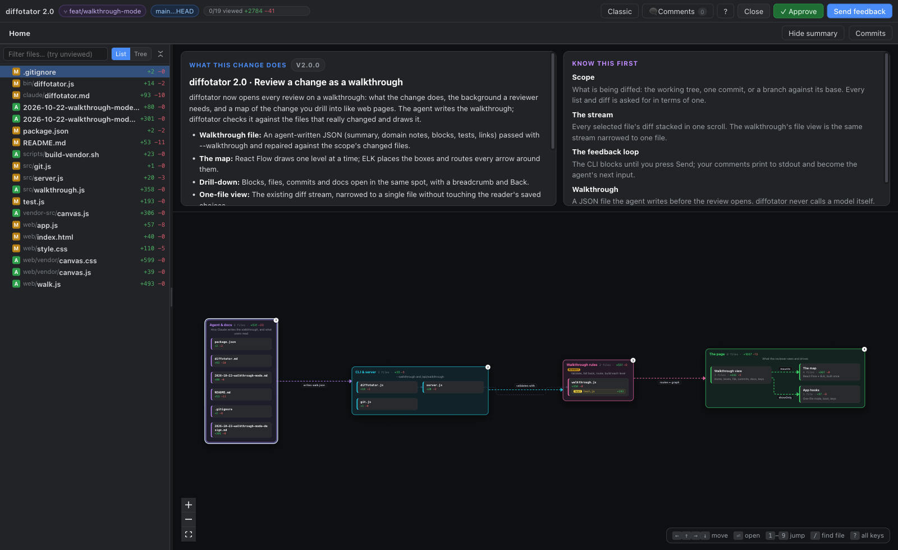
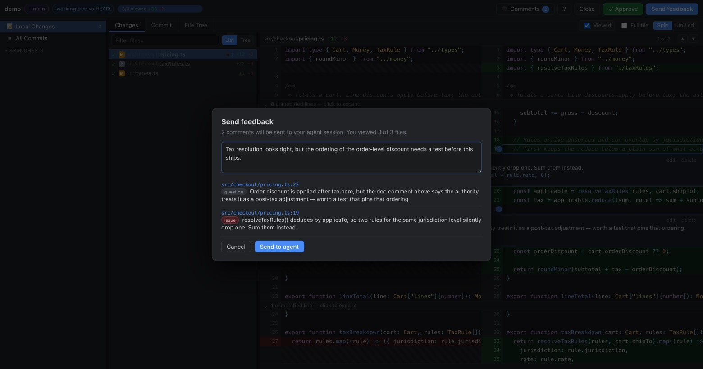
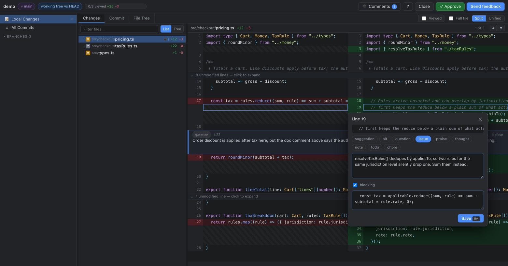
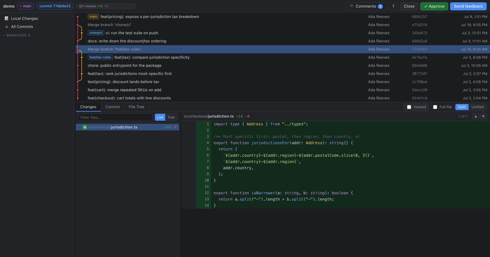

<div align="center">

# diffotator

**Review a 100-file change like a map, not a list — then send the comments back to your agent.**

diffotator opens every review on a **walkthrough**: what the change does, the
domain words you need, and a map of the change you drill into like web pages.
Under it sits a real git client. Your comments go straight back to Claude Code.

[](https://diffotator.vercel.app)
[](package.json)
[](https://www.npmjs.com/package/diffotator)
[](package.json)
[](#license)



</div>

## The walkthrough (new in 2.0)

Big changes are hard to review because a file list has no shape. The walkthrough
gives it one.

- **Home** — *What this change does* (summary, key changes, decisions, and the one
  place to look hardest) beside *Know this first* (the domain background, with links
  to the docs it came from). Below them, the map.
- **The map** — the change grouped into blocks by behaviour, drawn with
  [React Flow](https://reactflow.dev) and laid out by [ELK](https://eclipse.dev/elk/)
  so arrows route around boxes instead of through them. Every box shows what is
  inside it: blocks hold sub-blocks or files, files hold their tests. Labelled
  arrows say how blocks connect; dashed arrows trace file-to-file calls. Hover a box
  (or reach it with the arrow keys) and its arrows light up while the rest fade.
- **Drill in like a website** — click a block and the map becomes that block; click a
  file and its diff opens in the same spot; **← Back**, the breadcrumb or the browser's
  Back return. Commits and domain docs open in place too.
- **Keyboard first** — arrows move between boxes, `⏎` opens, `1`–`9` jump, `⌫` goes
  back, `j`/`k` walk files in walkthrough order (tests right after their file), `⇧T`
  flips between a file and its tests, `/` or `⌘K` finds any file. `?` lists them all.
- **Classic** is one click (or `⇧C`) away — everything below still works as before.

Claude writes the walkthrough. Ask *"Use diffotator to open this MR &lt;link&gt;"* and the
`/diffotator` command checks the MR out into a temporary worktree, reads the diff, the
ticket and your repo's own docs (`CONTEXT.md`, `AGENTS.md`, a handbook), writes the
walkthrough, and opens it. On someone else's MR it never edits their branch: your
`question:` comments are answered in chat, and the rest come back as draft review
comments that are posted only when you say so.

No walkthrough? diffotator still opens on the map, grouped by folder.

## Ask your agent without leaving the page (new in 2.2)

Press **Ask agent** (or `a`) and type a question. Your agent answers in the same
panel a moment later, and the review stays open — no switching back to the
terminal. Ask about a line by writing a comment and pressing **Ask agent now**.

The **merge confidence** chip at the top (High · Medium · Low) is your agent's
honest read of whether the change is safe to merge, with the reasons behind it.
Click it, then **Ask why**.

How it works: the review runs in a small background process. When you ask, the
agent's `diffotator` command finishes with your question; the agent replies with
`diffotator answer --id <n> "…"`, which also waits for your next message. If the
agent's command was stopped, nothing is lost: questions wait in line, and a
review you sent is handed to whichever `diffotator` command runs next.

Who can do what: only the page opened from the printed link can ask or send
(the link carries a key, and every request needs a header other websites can't
add), and only your agent can answer (it holds a secret stored where only you
can read it). The review closes itself after 12 hours without use. Reviewing
through a forwarded port in a cloud editor? Set `DIFFOTATOR_ALLOWED_HOSTS` to
its host name.

## Review first: files ranked by risk (new in 2.2)

Not every file deserves the same attention. diffotator ranks the changed files so
your careful reading goes where a mistake would cost the most:

- **High** (red dot) — CI workflows, auth and secrets, billing, database
  migrations, installers and release scripts, however small the change; or a large
  change with no test changed beside it.
- **Medium** (yellow dot) — dependency changes, mid-size changes, untested ones.
- **Low** (no dot) — docs, assets, lockfiles and small edits. Skim them.

The top five show on Home as **Review first**, each with its reasons; **Risk** in the
file list sorts every file that way; a file's page says why it ranked where it did.
Tests are left out — you read them with the file they check. Your agent can rate a
file itself when it knows better (`risk` in the walkthrough), but a sensitive path
never drops below High.

## What it is

Browse commits, files and diffs like [Fork](https://git-fork.com), annotate any line,
hit **Send feedback** — the comments land in your Claude Code session as markdown the
agent acts on. Same contract as [Plannotator](https://plannotator.ai), without the lag.

- **A whole git client, not a diff blob.** Commits, branches, worktrees, stashes and
  every file at any revision — so you can comment on code the change never touched.
- **Comments are instructions.** [Conventional Comments](https://conventionalcomments.org)
  labels, a blocking flag, optional suggested code, delivered as markdown on stdout.
- **Nothing to install into your repo.** One Node process, no install-time
  dependencies, no config. It reads git and exits when you're done.

## Install

Works the same on macOS, Linux and Windows. You need Node 18+ and git.

### Option 1 — npm (recommended)

```sh
npm install -g diffotator
diffotator setup             # teaches your agent the /diffotator command
```

Upgrade with `npm update -g diffotator`, then run `diffotator setup` again so your
agent gets the new instructions. Just trying it? `npx diffotator` runs it without installing.

### Option 2 — from source

```sh
git clone https://github.com/adisagar2003/diffotator.git
cd diffotator
npm link                     # puts the diffotator command on your PATH
diffotator setup
```

Upgrade with `git pull`, then `diffotator setup` again. Pick this to read the code,
try unreleased changes, or send a pull request. `node test.js` runs the checks.

### Then

`diffotator setup` installs the command for Claude Code and prints the instructions file
to add to any other agent's rules. Then ask your agent:

```text
use diffotator to review <pull request link>
```

Optional: `diffotator hook --install` opens a review on its own after every agent turn
(see [Reviews that fire by themselves](#reviews-that-fire-by-themselves)).

There are no runtime dependencies. The walkthrough map's React, React Flow and ELK ship
prebuilt in `web/vendor/` (rebuild with `scripts/build-vendor.sh` after editing `vendor-src/`).

## Use

```sh
diffotator                       # review the working tree
diffotator --base origin/main    # review the branch against a base
diffotator -C ../other-repo
diffotator --base origin/main --walkthrough walk.json   # open on an agent-written walkthrough
```

`--base` pins the base ref used for branch-vs-base — it reaches git, not just the
auto-detected default shown in the sidebar.

From your agent: `/diffotator`. The CLI blocks until you ask something or submit;
whatever it prints on stdout becomes the agent's next input.

| You do | Agent gets |
|---|---|
| **Ask agent** | `# Question from the reviewer` — it answers with `diffotator answer --id <n> "…"`, which waits for what you do next |
| **Send feedback** | `# Code review feedback` — grouped by file, blocking comments called out |
| **Approve** | `The user approved.` |
| **Close** | `Review session closed without feedback.` |

`Ctrl-C` only stops listening: the review stays open in the browser, and
`diffotator wait` listens again.



To review an MR or PR, give `/diffotator` its link — it fetches it into a temporary
worktree and writes the walkthrough. By hand: `glab mr checkout 123` (or
`gh pr checkout 123`), then `diffotator --base origin/main`.

## Reviews that fire by themselves

A review tool you have to remember to run reviews only what you remember to review.
`diffotator hook --install` adds a `Stop` hook to `~/.claude/settings.json` (backing that
file up first), so every turn leaving real changes opens a review on its own. Blocking
comments come back as the hook's `reason`, which sends the agent back to work with the
review in hand instead of spending a fresh turn.

The whole difficulty is *not* firing. It stays quiet when the tree is clean, when the
turn touched fewer than three files, when nothing changed since the last review, and
when the harness says a hook already blocked once — so it can't loop. "Nothing changed"
is a hash of `git status` plus `git diff HEAD`, not a file list, so an edit in place
re-opens the review while one more sentence from the agent doesn't.

```sh
DIFFOTATOR_HOOK=off             # disable without uninstalling
DIFFOTATOR_HOOK_MIN_FILES=3     # fewest changed files that will open a review
DIFFOTATOR_DEBUG=1              # log why a Stop was let through
diffotator hook --uninstall     # remove it again
```

## The review loop

The Changes tab is one stream: every selected file's diff, stacked back to back
in a single scroll, GitHub's Files-changed view rather than a picker plus a pane.
Each file list row has an eye; click it shut and the file drops out of the
stream, click `all`/`none` above the list to bulk in or out, and the fold
toggle beside them collapses every file at once — then flips, editor style,
to expand them again. `v` marks the
current file viewed, collapses it in the stream, and jumps to the next unviewed
one. The header tracks `12/56 viewed +2,341 −187`, viewed files dim with a ✓,
and a sticky bar at the top of the pane doubles as that file's header — click
the path to jump to its top, the caret to fold it, the checkbox to mark it
viewed without folding. That is the whole loop for a fifty-file agent run:
`v v v`, stop when something looks wrong, `c` to comment, keep going. Once
every selected file is viewed and folded, a finish card takes the stream's
place with **Send feedback** (`⌘⏎`) or **Approve**.

Click any line number to comment. Labels follow Conventional Comments — `suggestion`,
`nit`, `question`, `issue`, `praise`, `thought`, `note`, `todo`, `chore` — plus a
blocking flag and an optional suggested-code block.



Comments render inline under the line they are about, with their label, blocking flag
and edit/delete — so re-reading a file shows what you already said. Unsent comments and
viewed state live in `~/.local/share/diffotator` and are cleared when you submit; not in
`localStorage`, which is scoped to the origin *including the port*, and every run binds
a fresh one. Closing with unsent comments asks first.

## What's in the window

Left sidebar: Local Changes, branch-vs-base (auto-detected), All Commits, worktrees,
branches, tags, stashes, remotes. Top: commit graph with lanes, refs, author, sha, date.
Bottom: **Changes** (changed files + one continuous diff stream), **Commit**
(metadata + message), **File Tree** (every file in the repo at that revision,
untracked ones included).



The changed-files pane is a flat **List** by default (reviewing is working a list)
and a **Tree** for the 12k-path repo browser; single-child directory chains fold to
one row either way, and both carry the same per-file show/hide eye for changed
files, so the stream in/out toggle works from either tab. Split or unified, word-level
intra-line diff, collapsed context you can expand, `Full file` to review a change in
its surroundings, and the File Tree tab so you can comment on code the diff never
touched.

### Keys

`j`/`k` file · `n`/`p` change · `↑`/`↓` line cursor · `c` comment · `v` viewed +
next · `s` split/unified · `f` full file · `t` comments · `a` ask your agent · `/` filter files ·
`⌘F` find in file · `⌘⏎` save/send · `Esc` close

Walkthrough adds: `←↑→↓` move between boxes · `⏎` open · `1`–`9` open box N ·
`⌫`/`Esc` back · `g` home · `0` fit · `+`/`−` zoom · `m` summary · `⇧T` file ↔ tests ·
`/` or `⌘K` go to file · `h` commits · `⇧C` Classic

Windowing means only the visible rows exist in the DOM, so the browser's own Find
cannot see the file — `⌘F` opens ours instead.

## Why it's fast

The lag in a browser diff viewer comes from shipping the whole review as one document.
This does the opposite:

- git data is fetched per file, on demand — nothing is inlined into the page
- commit list and diff rows are windowed; only what's on screen is in the DOM
  (a 61k-line minified JSON diff opens instantly)
- fixed row heights, so windowing needs no measurement pass
- syntax highlighting runs on visible rows only, from a ~100-line regex tokenizer
  instead of a grammar bundle
- one `git diff -U1000000` per file, so expanding collapsed context is free
- rows are uniform 20px except inline comment cards, whose height is *derived*
  rather than measured, so a prefix-sum index stays exact and nothing jumps

## Not built

Staging, committing, push/pull, rebase, blame, merge conflicts, image diffs — use Fork
for those. diffotator itself never talks to GitHub or GitLab; the `/diffotator`
command does that, through `gh`/`glab`, and only posts when you say so.

## Git shapes that bite

Most diff viewers are written against a straight line of ordinary commits. These
were all real bugs here, and each one has a test:

| Shape | What went wrong |
|---|---|
| Root commit | `sha^!` has no parent to exclude — the diff came out reversed |
| Merge commit | `sha^!` excludes *every* parent, so it showed zero files |
| Rename | `numstat` compresses the path to `{old => new}` — every rename read +0/−0 |
| CRLF file | a stray `\r` rendered at the end of every line |
| Any file ending in a newline | a phantom empty last line |
| Binary | rendered as a blank pane instead of saying "binary" |
| Untracked | missing from the File Tree — exactly the files an agent just wrote |

Commits now resolve to an explicit two-dot pair against the first parent (or the
empty tree at the root), which is also what makes a merge show what it merged in.

## Links

[Docs](https://diffotator.vercel.app/docs) ·
[CLI reference](https://diffotator.vercel.app/docs#cli) ·
[GitHub](https://github.com/adisagar2003/diffotator)

## License

MIT
